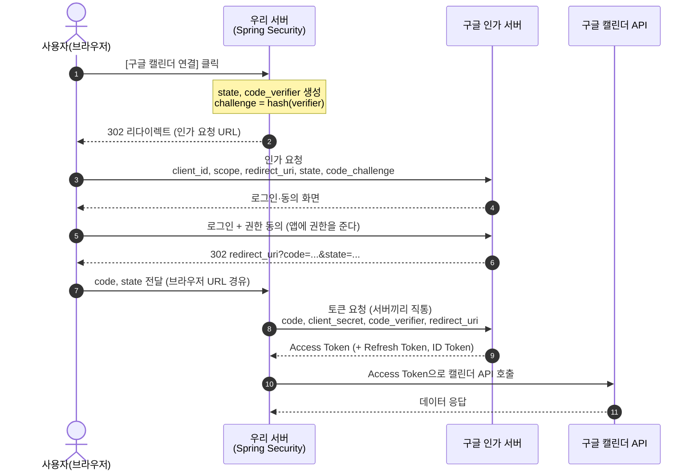
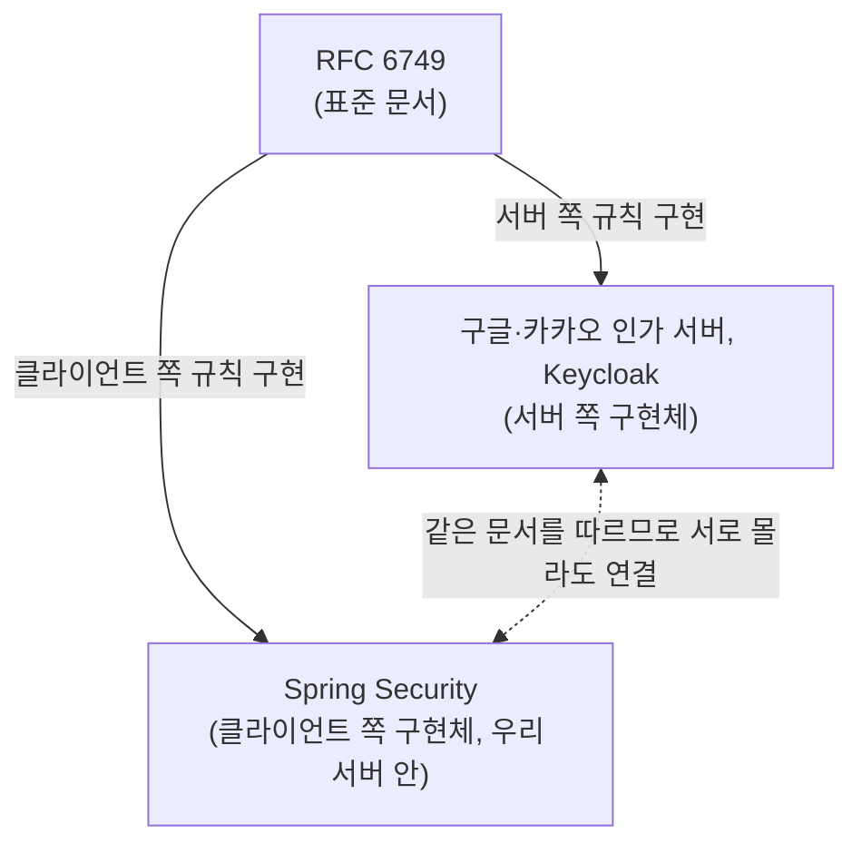

# OAuth2 Authorization Code 흐름과 구현체

소셜 로그인을 붙이다 보면 "토큰은 언제 받는 거지?", "OAuth2는 구글이 만든 건가 Spring이 만든 건가?"가 헷갈린다. 흐름 → 표준과 구현체의 관계 → 누가 어떤 검사를 책임지는지 순서로 정리한다.

> 관련 노트: [[카카오 소셜 로그인]], [[웹이랑 앱 소셜 로그인 차이]]

## 1. 토큰은 어떻게 발급되나: Authorization Code 흐름

사용자가 앱에 권한을 준 결과는 바로 토큰이 아니라 **인가 코드**다. 토큰은 우리 서버가 그 코드를 인가 서버에 직접 내밀고 교환해서 받는다. 예시는 "우리 앱에서 [구글 캘린더 연결] 버튼을 누른 상황"이다.

- **3번**: 우리 서버가 "어느 앱(client_id)이, 어떤 권한(scope)을, 끝나면 어디(redirect_uri)로"를 담아 요청한다. 여기서 보낸 client_id가 나중에 ID Token의 `aud`가 된다.
- **5번**: "앱에 권한을 준다"가 이 순간이다. 비밀번호는 구글에만 입력하고, 우리 서버는 끝까지 보지 못한다.
- **6~7번**: 브라우저 URL을 거치는 구간이라 탈취될 수 있다. 그래서 그 자체로는 쓸모없는 교환권인 code만 싣는다. code는 1회용이고 수명이 짧다.
- **8~9번**: 실제 토큰 발급 지점이다. 서버끼리 직통으로 통신하고, client_secret(또는 PKCE의 code_verifier)이 없으면 code를 훔쳤어도 여기서 막힌다.
- **3번과 8번의 짝**: 3번에 해시값(challenge)을, 8번에 원본(verifier)을 보내는 것이 PKCE다. 인가 서버는 원본을 해시해서 3번 값과 같은지 본다.

한 줄로 줄이면 **동의 → 코드(브라우저로) → 토큰(서버끼리 직통)**이다.

## 2. 이 흐름은 누가 정하고 누가 구현하나

위 단계의 순서와 파라미터 이름을 정한 건 특정 회사가 아니라 **RFC 6749**라는 표준 문서다. OAuth2는 설치하는 프로그램이 아니라 이 문서 자체고, 구글 인가 서버와 Spring Security는 각각 그 문서의 **서버 쪽**과 **클라이언트 쪽** 규칙을 구현한 것이다. 양쪽이 같은 문서를 따르니 서로 몰라도 연결된다.

HTTP와 같은 구도다. HTTP도 RFC 문서이고, Tomcat·Nginx·크롬은 그 구현체다.

|  | 표준 문서 | 구현체 |
| --- | --- | --- |
| HTTP | RFC 9110 등 | Tomcat, Nginx, 크롬 |
| OAuth2 | RFC 6749, 6750 | 구글·카카오 인가 서버, Spring Security, Keycloak |

### 문서가 정한 것과 비워둔 것

RFC 6749는 뼈대만 정하고 상당 부분을 비워둔 **프레임워크**다.

- **정한 것(뼈대)**: 4가지 역할, 엔드포인트 종류, 흐름(grant type), 파라미터 이름(`client_id`, `redirect_uri`, `code` 등), 토큰 응답 형식, 에러 코드
- **비워둔 것(빈칸)**: 엔드포인트 주소, scope 이름, 토큰 형식·수명, 사용자 정보 형식, 로그인(인증)

뼈대는 IETF OAuth Working Group이 관리하지만 강제력은 없다. 빈칸은 인가 서버 운영자가 자기 정책으로 채우고, 여러 업체에 공통인 빈칸은 **OIDC·PKCE 같은 확장 스펙**이 메운다. 그래서 같은 OAuth2여도 구글과 카카오의 설정은 다르고, 스펙에서 벗어난 동작(GitHub의 폼 인코딩 토큰 응답 등)은 라이브러리가 흡수한다.

## 3. 누가 어느 규칙을 지키나

강제하는 기관이 없으니, 실제 요청이 오갈 때 규칙을 지키게 만드는 건 구현체들이다. 1장의 흐름을 다시 보면, **인가 서버가 문 앞에서 요청을 걸러내고, 나머지 검사는 클라이언트 쪽(Spring Security)이 직접** 한다.

| 검사 | 누가 | 왜 그쪽 몫인가 |
| --- | --- | --- |
| client_id·redirect_uri·scope | 인가 서버 | 등록된 앱 정보는 인가 서버만 앎 |
| secret·code·PKCE | 인가 서버 | code를 발급한 것도 인가 서버 |
| state 비교 | Spring Security | 요청을 시작한 게 우리 앱인지는 우리만 앎 |
| ID Token의 aud·nonce | Spring Security | 토큰을 받는 쪽이 우리 |
| client_secret 보관 | 우리 서버 | 새면 인가 서버도 구분할 수 없음 |

인가 서버가 제 몫을 다 해도, 클라이언트가 `aud` 검증을 빠뜨리면 **다른 앱에 발급된 토큰으로 로그인이 뚫린다(토큰 치환 공격)**. 그래서 클라이언트 쪽 규칙은 직접 구현하지 않고 Spring Security 같은 검증된 라이브러리에 맡기는 것이 정석이다.

## 한 줄 정리
> 동의 → 코드(브라우저) → 토큰(서버 직통). OAuth2는 RFC 6749라는 문서이고, 구글 인가 서버는 서버 쪽, Spring Security는 클라이언트 쪽 구현체다. 인가 서버는 앱·코드를, 클라이언트는 state·aud·nonce를 검증한다.
